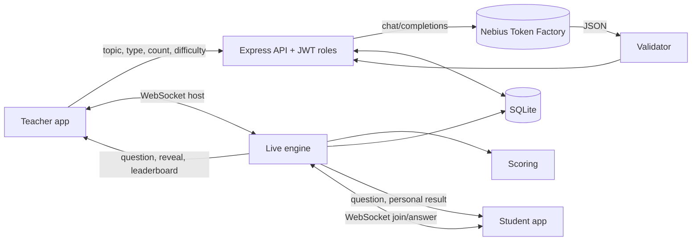

# QuizForge

**A live, AI-powered classroom quiz platform.** A teacher describes a topic, AI drafts the questions, students join with a code and answer in real time, and a leaderboard updates the moment each question closes.

Built for the **Nebius x NVIDIA hackathon** with Nebius Token Factory as the AI backend.

| Teacher app (`/teacher`) | Student app (`/student`) |
|---|---|
| Generate questions by topic, type, count and difficulty; edit them; host live; see results and AI insights | Join with a 5-letter code, answer on any device, see personal result, rank and final podium |

Both apps are served by one Node server and share auth, REST API and WebSocket.

## Quick start (about 60 seconds)

```bash
npm install
cp .env.example .env        # then paste your Nebius Token Factory key into NEBIUS_API_KEY
npm start                   # http://localhost:3000
```

No key? It still works: a built-in offline question bank is used so you can demo the live flow immediately.

**Try it with 3 browser windows:** (1) register as a teacher at `/`, generate a quiz and click *Save & go live*; (2) and (3) register two students (use a private window for the second), enter the code. Start the quiz from the teacher window.

### Configuration (`.env`)

| Variable | Purpose |
|---|---|
| `NEBIUS_API_KEY` | Your Nebius Token Factory API key (server-side only) |
| `NEBIUS_BASE_URL` | Defaults to `https://api.tokenfactory.nebius.com/v1` |
| `NEBIUS_MODEL` | Any chat model enabled on your account (default `meta-llama/Llama-3.3-70B-Instruct`; check the Token Factory console for the exact model IDs you have) |
| `JWT_SECRET` | Required in production |
| `DB_PATH`, `PORT` | SQLite file location and port |

## Architecture



Full state machine, decision table and scaling path: [`docs/ARCHITECTURE.md`](docs/ARCHITECTURE.md).

### Key design decisions

- **Server-authoritative game logic.** The server owns the clock, grading and scores; students never receive the correct answer before reveal (asserted in an e2e test).
- **LLM output is untrusted.** Every generated question is schema-validated; failures retry once, then fall back to an offline bank so a class is never blocked.
- **Early reveal.** When every connected student has answered, the question closes immediately.
- **Reconnect-safe.** Refreshing a student tab restores the current question, remaining time and score.
- **SQLite + in-memory live state** for zero-ops deployment; Redis/Postgres is the documented scale-out path.

### My additions (engineering judgement)

1. **Speed + streak scoring** (500 base + up to 500 speed + up to 250 streak bonus), implemented as a pure, unit-tested function.
2. **AI teaching insights**: after a session, per-question accuracy is turned into "what they understood, likely misconceptions, one re-teach activity".
3. **Built-in measurement**: `/api/metrics` exposes latency percentiles and a load-test script reproduces the numbers below.

## Measured results

Run `npm run loadtest` (200 simulated students x 3 questions, real WebSockets, one Node process, loopback network, Node 22):

| Metric | Result |
|---|---|
| Answers persisted | 600 / 600 |
| Question fan-out to 200 clients | p50 5.4 ms, p95 9.0 ms |
| Answer ack round-trip | p50 0.4 ms, p95 0.7 ms |
| Server answer handling (grade + score + SQLite write) | p50 0.11 ms, p95 0.2 ms |
| Personalised reveal fan-out (200 messages) | p95 4.1 ms |
| Memory | about 100 MB RSS |

These are loopback numbers on a single machine, so real-world latency will be dominated by the network. Treat them as a measure of server overhead, not an internet benchmark. `npm test` runs 9 tests (scoring, validation and a full teacher + 2-student live session).

## Project layout

```
server/   app.js  routes.js  engine.js  ws.js  ai.js  scoring.js  questions.js  auth.js  db.js  metrics.js
public/   index.html  teacher.html  student.html  css/app.css  js/{common,login,teacher,student}.js
tests/    scoring.test.js  e2e.test.js
scripts/  loadtest.js
MASTER_PROMPT.md   docs/ARCHITECTURE.md   Dockerfile
```

## Deploy

Any host that runs Node 20+ and supports WebSockets works (Render, Railway, Fly.io, a VM).

```bash
docker build -t quizforge .
docker run -p 3000:3000 -v quizforge-data:/data -e JWT_SECRET=$(openssl rand -hex 32) -e NEBIUS_API_KEY=... quizforge
```

Keep a single instance while room state is in memory (see the scaling path).

## Not implemented (honest list)

- Vector-based personalization of follow-up quizzes.
- Multi-instance scaling (needs Redis pub/sub).
- Resuming a live session after a server restart (saved results survive; the live room does not).
- Email verification and password reset.

## Resume bullets (adapt to your own numbers)

- Built **QuizForge**, a real-time classroom quiz platform (Node.js, WebSockets, SQLite) with separate teacher and student apps, role-based auth and a live leaderboard; sustained 350+ answers/s with p95 server handling under 1 ms in a 200-student simulation.
- Integrated **Nebius Token Factory** LLMs to generate quizzes from topic, type and difficulty; added schema validation, retry and offline fallback so malformed model output never interrupts a live class.
- Designed a **server-authoritative game engine** (state machine, server-side timing, answer secrecy until reveal, duplicate/late-answer rejection) and verified it with an end-to-end test using real WebSocket clients.
- Added speed/streak scoring and AI-generated post-session teaching insights to turn quiz results into actionable feedback for teachers.
