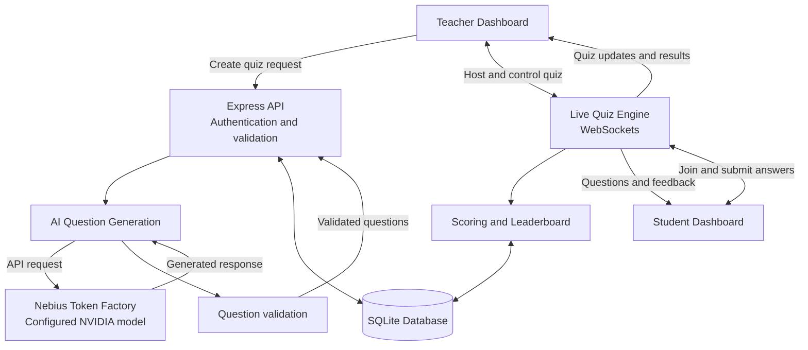

# ⚡ QuizForge — AI-Powered Live Quiz Platform

**Turn any classroom into an interactive, AI-powered quiz arena.**

QuizForge is a live quiz platform designed to help teachers create quizzes and engage students through real-time participation, automatic scoring, and leaderboards. It integrates **Nebius Token Factory** for AI-powered question generation using a configured NVIDIA model.

> Built for the Nebius × NVIDIA Global AI Hackathon.

## ✨ Features

- 🤖 **AI Question Generation** — Generate quiz questions from a topic, difficulty, question type, and requested question count.
- 🎮 **Live Multiplayer Quizzes** — Let students join and participate in teacher-hosted quiz sessions.
- ⚡ **Real-Time Communication** — Use WebSockets to distribute questions, answers, and quiz updates.
- 🏆 **Live Leaderboards** — Track scores and display rankings during a quiz.
- 👨‍🏫 **Teacher Experience** — Create quizzes, host sessions, and control quiz progression.
- 🎓 **Student Experience** — Join sessions, answer questions, and view results.
- 🔐 **Authentication** — JWT-based authentication and role-aware access.
- 💾 **Persistent Storage** — Store application data using SQLite.
- 🛟 **Fallback Question Bank** — Support offline question generation when the AI service is unavailable, where implemented.

## 🧰 Tech Stack

| Component | Technology |
|---|---|
| Runtime | Node.js |
| Backend | Express.js |
| AI inference | Nebius Token Factory |
| AI model | NVIDIA model configured through environment variables |
| Real-time communication | WebSockets |
| Database | SQLite |
| Authentication | JSON Web Tokens (JWT) |
| Testing | Project test suite |

## 🏗️ Architecture



## 🧠 AI Integration

QuizForge connects to Nebius Token Factory through an OpenAI-compatible API to generate quiz questions.

The configured model is selected through the `NEBIUS_MODEL` environment variable. Keep model configuration separate from source code so that supported models can be changed without modifying the application.

AI-generated output should be validated before it is used in a live quiz. If the AI service is unavailable, the application can use its fallback question bank where supported by the implementation.

**Security:** Never commit API keys or other secrets to GitHub. Store them in your local `.env` file.

## 🚀 Getting Started

### Prerequisites

Install the following:

- Node.js 20 or later
- npm
- Git
- A Nebius Token Factory API key for AI-powered question generation

### 1. Clone the repository

```bash
git clone https://github.com/Vinod-dead/QuizForze.git
cd QuizForze
```

### 2. Install dependencies

```bash
npm ci
```

### 3. Configure environment variables

Create a local `.env` file using `.env.example` as a reference.

```powershell
Copy-Item .env.example .env
```

Open `.env` and configure the variables required by the project, including your Nebius API key and desired model.

Do not paste your API key into source files, README examples, screenshots, or public commits.

### 4. Start the application

Use the start command defined in `package.json`. For example, if the project defines `npm start`:

```bash
npm start
```

If the project uses a different script, use the corresponding command from `package.json`.

## 🧪 Testing

Install dependencies before running the project's test suite:

```bash
npm test
```

Check the output for the actual test results. Test coverage and performance figures should only be published when they have been measured and verified.

## 🎯 Typical Workflow

1. A teacher opens the platform and creates a quiz.
2. The teacher provides a topic and question-generation preferences.
3. QuizForge requests AI-generated questions from Nebius Token Factory.
4. The application validates the generated questions.
5. The teacher hosts a live quiz session.
6. Students join and submit their answers in real time.
7. QuizForge updates scores and displays results.

## 🔒 Security and Reliability

- Keep `.env` and all API credentials private.
- Validate AI-generated content before displaying it to students.
- Handle unavailable AI services gracefully.
- Validate authentication and authorization on protected routes.
- Test WebSocket connections and session handling.
- Do not expose private student information in public logs or leaderboards.

## 🗺️ Roadmap

Potential improvements include:

- More question formats and configurable quiz templates.
- Improved question-quality checks.
- Session analytics and downloadable reports.
- Additional accessibility and classroom customization options.
- More robust error handling and automated tests.

## 🤝 Contributing

Contributions, bug reports, and feature suggestions are welcome. Open an issue to discuss a change before submitting a pull request.

## 📄 License

A license has not been specified here. Add a `LICENSE` file only after choosing a license that is appropriate for the project's code and assets.

---

**QuizForge — Create. Play. Learn.**