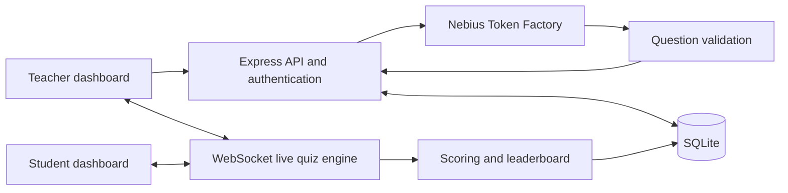

# QuizForge

**An AI-powered live quiz platform for interactive classroom learning.**

QuizForge helps teachers create topic-based quizzes with AI, host live classroom sessions, and understand student performance through real-time scoring, leaderboards, and AI-generated teaching insights.

Built for the **Nebius × NVIDIA hackathon**, QuizForge integrates NVIDIA Nemotron through Nebius Token Factory.

## Features

### Teacher dashboard
- Generate questions by topic, question type, count, and difficulty.
- Review and edit questions before hosting.
- Run live quiz sessions and monitor results.
- View leaderboards and AI-generated teaching insights.

### Student dashboard
- Join live quizzes using a five-character room code.
- Answer questions from supported devices.
- Receive personal results, scores, and rankings.
- Participate in a real-time classroom quiz experience.

### AI and reliability
- NVIDIA Nemotron model integration through Nebius Token Factory.
- Schema validation for generated questions.
- Retry handling and offline question-bank fallback.
- AI-assisted teaching insights based on question-level accuracy.

### Real-time architecture
- Node.js and Express server.
- WebSocket-based quiz events.
- Server-authoritative scoring and answer validation.
- SQLite persistence for quiz data and results.

## Quick start

**Requirements:** Node.js 20 or later and npm.

```bash
npm install
```

Create your local environment file:

```bash
# macOS/Linux
cp .env.example .env

# Windows PowerShell
Copy-Item .env.example .env
```

Edit `.env` and set your Nebius Token Factory API key:

```env
NEBIUS_API_KEY=your_api_key_here
NEBIUS_BASE_URL=https://api.tokenfactory.nebius.com/v1
NEBIUS_MODEL=nvidia/Nemotron-3_5-Lightning
JWT_SECRET=replace_with_a_long_random_secret
PORT=3000
DB_PATH=./data/quizforge.db
```

Use a model ID enabled for your Nebius account. Keep API keys and production secrets private.

Start the application:

```bash
npm start
```

Open `http://localhost:3000`.

Without an API key, the application can use its built-in offline question bank, subject to the available fallback questions.

## Try a live quiz

1. Open the application and register as a teacher.
2. Generate a quiz, review the questions, and save it as a live session.
3. Open the student page in another browser window or private session.
4. Register as a student and join using the room code.
5. Start the quiz and test answering, scoring, and leaderboard updates.

## Technology stack

- **AI inference:** Nebius Token Factory
- **AI model:** NVIDIA Nemotron 3.5 Lightning
- **Backend:** Node.js and Express
- **Real-time communication:** WebSockets
- **Database:** SQLite
- **Authentication:** JWT
- **Testing:** Node.js test runner and project test suite

## Architecture



See [`docs/ARCHITECTURE.md`](docs/ARCHITECTURE.md) for further technical details.

## Testing

Run the project's tests:

```bash
npm test
```

If the load-test script is available, run:

```bash
npm run loadtest
```

Load-test measurements depend on the environment. Any reported benchmark should include the test conditions and should not be interpreted as a guarantee of production internet performance.

## Project structure

```text
server/       API, AI integration, authentication, scoring, and live engine
public/       Teacher and student interfaces
tests/        Automated tests
scripts/      Load-testing utilities
docs/         Architecture documentation
```

## Deployment

QuizForge can be deployed to a Node.js host that supports WebSockets and persistent storage.

Configure the required environment variables in your hosting provider's secret manager. Use persistent storage for SQLite and keep a single application instance while live room state remains in memory.

A multi-instance deployment would require shared live state and coordination, such as Redis-based pub/sub.

## Current limitations

- Vector-based personalization of follow-up quizzes is not implemented.
- Multi-instance scaling requires shared live state.
- Live rooms do not resume after a server restart.
- Email verification and password reset are not implemented.

## License

See [`LICENSE`](LICENSE).
