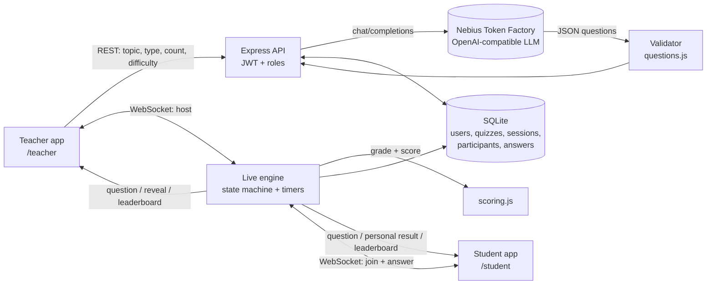

# QuizForge architecture



## Session state machine

```
lobby --next--> question --timer | all answered | teacher--> reveal --next--> question ... --> finished
```

The server owns the clock, the grading and the scores. Clients only render what they are told.

## Key design decisions

| Decision | Why | Trade-off |
|---|---|---|
| **Server-authoritative timing and scoring** | A student can't cheat by editing client JS or the clock; elapsed time is `now - question.openedAt` on the server. | Slightly more server work per answer (measured ~0.1 ms). |
| **Correct answer never sent before reveal** | Prevents reading the answer from the network tab. Covered by an e2e test (`question.answer === undefined`). | Reveal needs a second broadcast. |
| **LLM output is untrusted** | Every generated question passes `normalizeQuestion()` (shape, 2-6 unique options, valid answer index, length caps). Bad output is retried once, then falls back to an offline bank so a class is never blocked. | A little code, a lot of reliability. |
| **Topic treated as data, not instructions** | Mitigates prompt injection from the topic field; output is schema-validated anyway. | Not a complete defence on its own, hence the validator. |
| **Early reveal when everyone answered** | Keeps lessons snappy. | Disconnected students don't block the room. |
| **Streak + speed scoring (own feature)** | Rewards both accuracy and recall speed and keeps the leaderboard competitive to the end. | Slightly favours fast readers; capped bonuses limit it. |
| **AI "teaching insights" after a session (own feature)** | Closes the loop for the teacher: per-question accuracy in, re-teach plan out. | One extra LLM call, rate limited. |
| **SQLite (WAL) + in-memory live state** | Zero-ops, ACID answer writes, trivially deployable. Live room state is small. | A server restart ends in-flight live sessions (saved results remain). |
| **Single origin for both apps** | `/teacher` and `/student` share auth, API and WebSocket; no CORS. | - |

## Scaling path (not implemented, by design)

1. Move live room state to Redis and fan out via Redis pub/sub so several Node processes can serve one session.
2. Swap SQLite for Postgres (the SQL is plain and portable).
3. Put the WebSocket tier behind a sticky load balancer.

## Security notes

- bcrypt password hashes, 12h JWTs, role checks on every REST route and on WebSocket `host` / `join`.
- Rate limits on auth and AI endpoints; 4 KB WebSocket payload cap; 200 KB JSON body cap.
- Strict CSP (`script-src 'self'`), UI text set via `textContent`, parameterised SQL only.
- Only the owning teacher can host a session or read its results; students can only join codes that are live.
